# DramaStream

**A Netflix-inspired streaming catalog for drama films, drama series and drama documentaries.**

### [Visit the live site: drama-stream-rho.vercel.app](https://drama-stream-rho.vercel.app/)

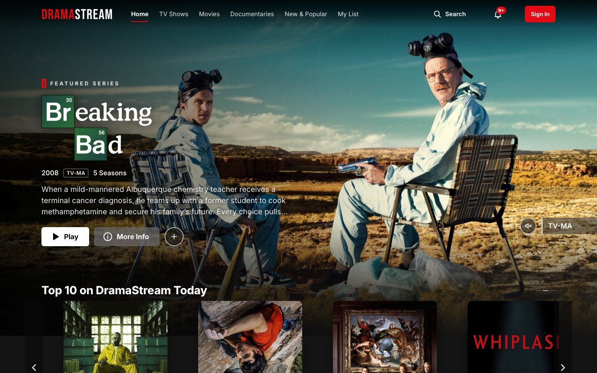

> DramaStream is an educational, Netflix-inspired project. It is not affiliated with Netflix, and it streams no films or episodes: the player is a clearly labelled mock-up.

[What you can do](#what-you-can-do) · [Screenshots](#screenshots) · [The catalog](#the-catalog) · [Accounts and profiles](#accounts-and-profiles) · [Live data from TMDB](#live-data-from-tmdb) · [Privacy](#privacy) · [Accessibility](#accessibility) · [Credits](#credits) · [About this project](#about-this-project)

## What you can do

| Area | What it offers |
|---|---|
| Browse | A billboard that changes between visits, Continue Watching, a Top 10 with big rank numbers, Trending Now, New Releases, "Because you watched…" and "Because you liked…" rows, and a row for every genre. Hover a poster for Play, My List, Rate, More Info, % Match, maturity rating, length and genres. |
| Titles | Details open over the page you were on, and every title has its own shareable link. Series list every season and episode with stills and synopses. Each title shows its cast, similar titles and an About section, and most have an official trailer that plays in an accessible dialog. |
| Search and browse | Search by title, actor, director or genre. Partial names and accents work, and "Explore titles related to…" suggestions help you keep going. TV Shows, Movies and Documentaries pages have a genre filter. |
| More from TMDB | Search also reaches The Movie Database: titles that aren't in the DramaStream catalog appear under your matches, each with an overview, genres, creator or director and cast. Click any actor, on those titles or on DramaStream's own, for their photo, biography and best-known films and series. |
| New & Popular | Coming Soon titles with a **Remind Me** button, New on DramaStream, and the Top 10. The notifications bell lists new arrivals and reminders that have come true. |
| Player | A mock player (no video plays) with play and pause, seeking, ±10 seconds, playback speed, simulated volume, full screen, Skip Intro, a Next Episode countdown with autoplay, and an Audio & Subtitles menu. Keyboard shortcuts: Space or K, ←/→, F, M, ↑/↓. It remembers where you stopped. |
| My List and ratings | Save titles to My List and sort it by date added, A–Z, Z–A or release year. Rate titles *Not for me*, *I like this* or *Love this!*, write reviews, and share a title. Your ratings drive the % Match scores and the "Because you liked…" row. |
| Accounts (optional) | Everything above works without an account. Signing up adds profiles, saved lists and progress, Kids profiles and more. See [Accounts and profiles](#accounts-and-profiles). |

## Screenshots

| | |
|---|---|
| 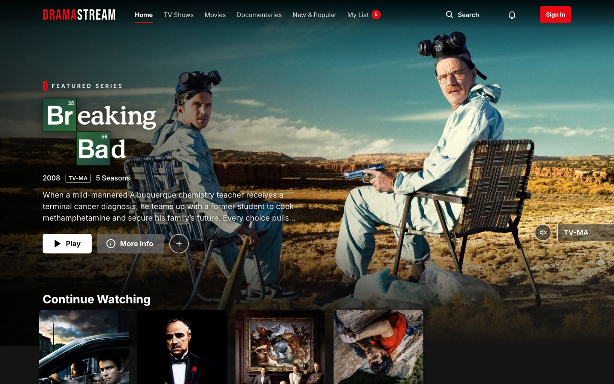 | 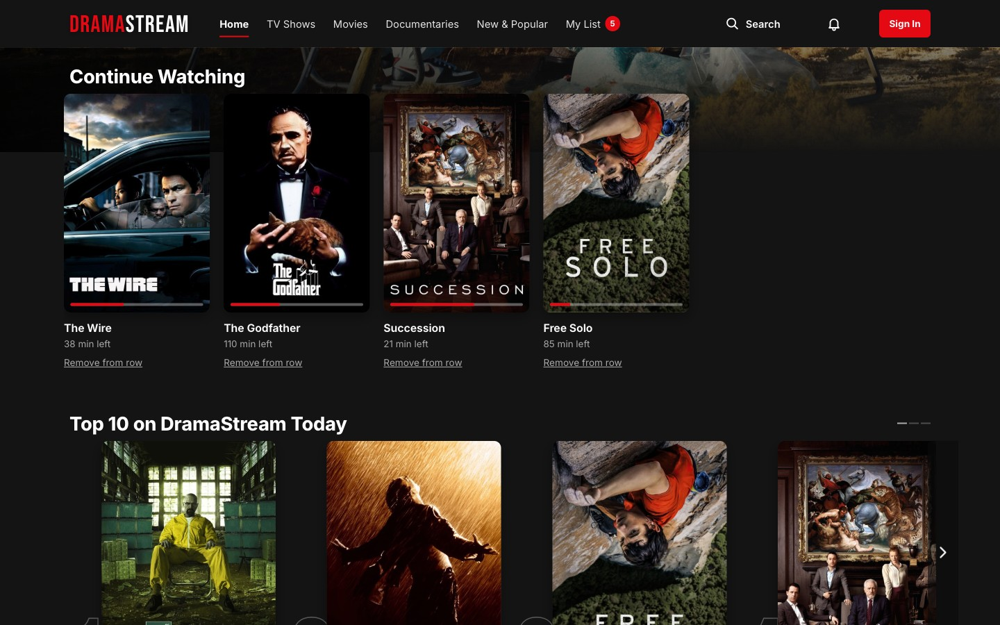 |
| **Home** | **Continue Watching and Top 10** |
|  | 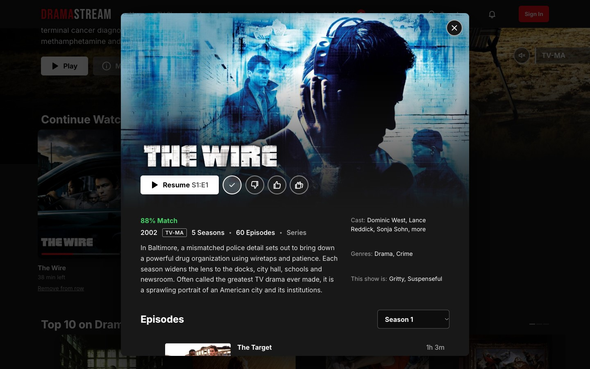 |
| **Hover card and % Match** | **Details modal** |
|  | 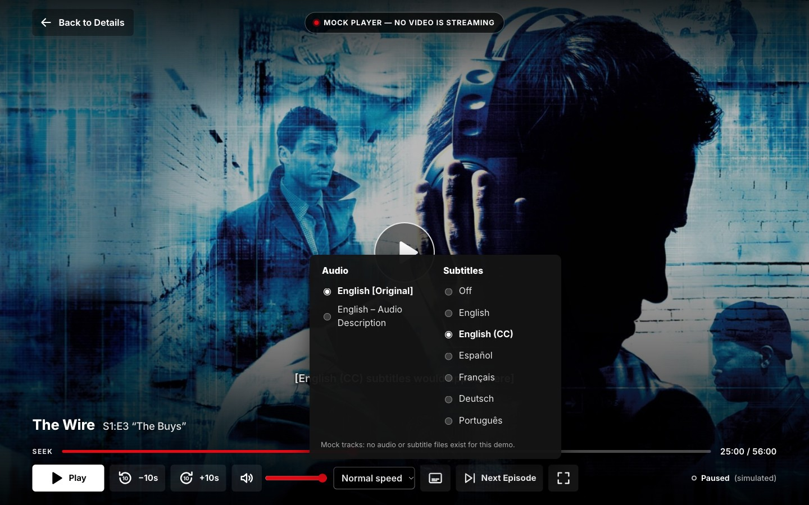 |
| **Episodes** | **Player: Audio & Subtitles** |
| 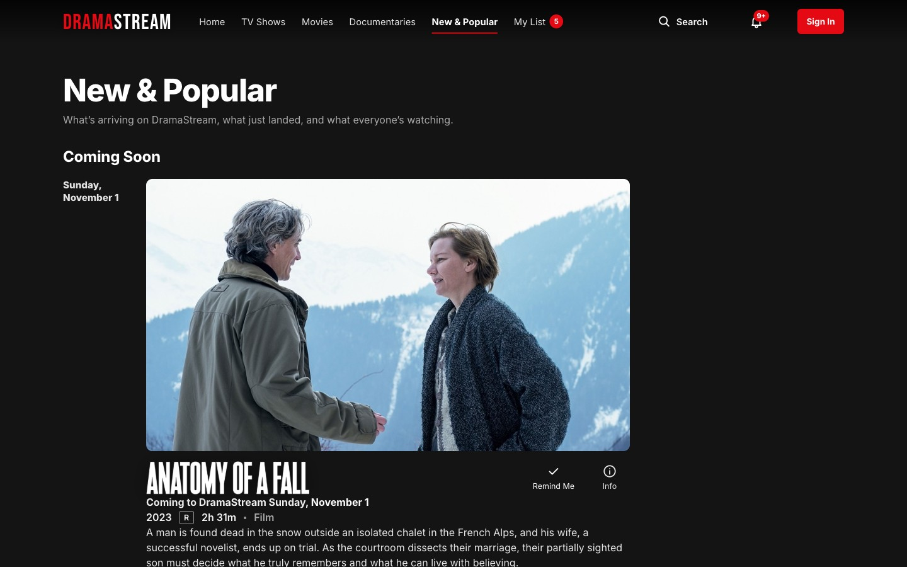 |  |
| **New & Popular** | **Notifications** |
|  | 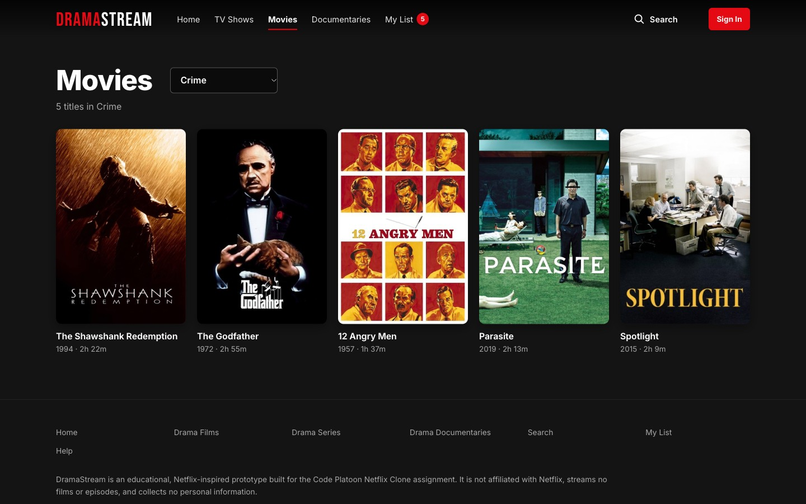 |
| **Search by person** | **Browse with a genre filter** |
| 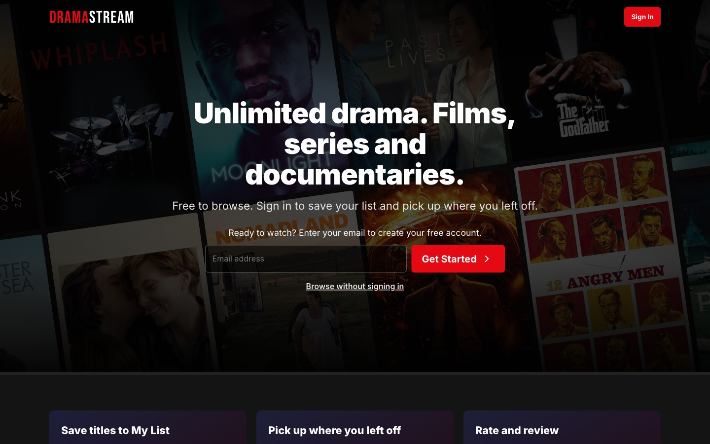 | 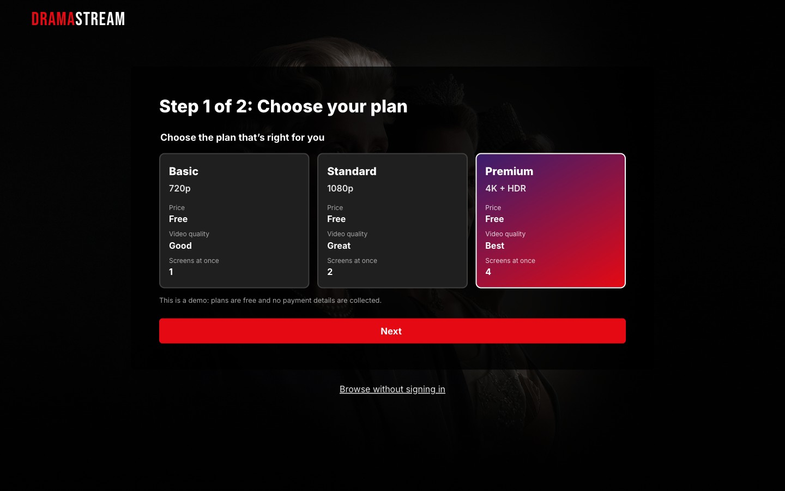 |
| **Welcome page** | **Plan step** |
| 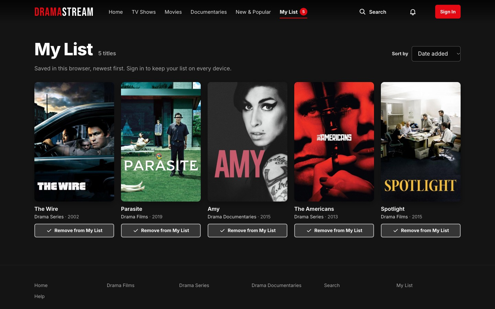 |  |
| **My List** | **Ratings and reviews** |
|  | 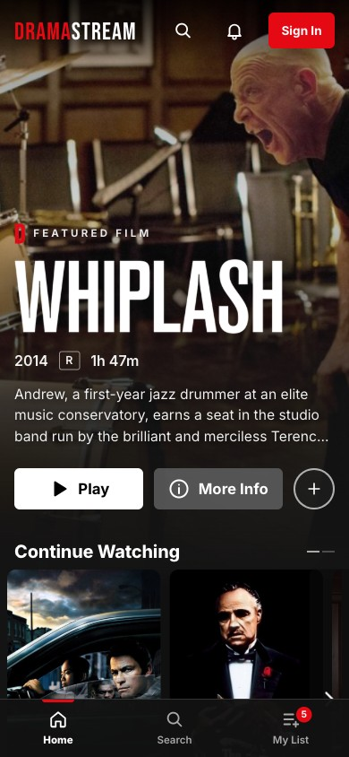 |
| **Share menu** | **Phone layout** |
|  | |
| **Trailer player** | |

The screens that need an account (Who's watching?, profile settings, Account and Viewing activity) aren't pictured.

## The catalog

**60 titles**, 20 in each row, plus **6 Coming Soon** titles. **Breaking Bad** is the featured title. Every series lists all of its episodes, 850 in total, each with a still and a synopsis.

| Drama Films | Drama Series | Drama Documentaries |
|---|---|---|
| The Shawshank Redemption (1994, R) | **Breaking Bad** (2008, TV-MA) | Free Solo (2018, PG-13) |
| Whiplash (2014, R) | Succession (2018, TV-MA) | 13th (2016, TV-MA) |
| Moonlight (2016, R) | The Crown (2016, TV-MA) | My Octopus Teacher (2020, TV-PG) |
| Past Lives (2023, PG-13) | Normal People (2020, TV-MA) | Won’t You Be My Neighbor? (2018, PG-13) |
| The Godfather (1972, R) | Better Call Saul (2015, TV-MA) | Man on Wire (2008, PG-13) |
| Schindler’s List (1993, R) | Mad Men (2007, TV-14) | Searching for Sugar Man (2012, PG-13) |
| Manchester by the Sea (2016, R) | Chernobyl (2019, TV-MA) | Jiro Dreams of Sushi (2011, PG) |
| Marriage Story (2019, R) | The Sopranos (1999, TV-MA) | Icarus (2017, NR) |
| Nomadland (2021, R) | Mare of Easttown (2021, TV-MA) | Senna (2010, PG-13) |
| Oppenheimer (2023, R) | The Queen’s Gambit (2020, TV-MA) | American Factory (2019, NR) |
| 12 Angry Men (1957, NR) | The Wire (2002, TV-MA) | Hoop Dreams (1994, PG-13) |
| Parasite (2019, R) | Six Feet Under (2001, TV-MA) | Amy (2015, R) |
| The Pianist (2002, R) | Friday Night Lights (2006, TV-14) | Three Identical Strangers (2018, PG-13) |
| Room (2015, R) | The Leftovers (2014, TV-MA) | Blackfish (2013, PG-13) |
| Lady Bird (2017, R) | Band of Brothers (2001, TV-MA) | Citizenfour (2014, R) |
| The Social Network (2010, PG-13) | The Americans (2013, TV-MA) | I Am Not Your Negro (2017, R) |
| Spotlight (2015, R) | Halt and Catch Fire (2014, TV-14) | Minding the Gap (2018, NR) |
| Roma (2018, R) | Downton Abbey (2010, TV-14) | Honeyland (2019, NR) |
| Aftersun (2022, R) | Shōgun (2024, TV-MA) | Grizzly Man (2005, R) |
| Boyhood (2014, R) | The Night Of (2016, TV-MA) | The Act of Killing (2012, NR) |

**Coming Soon:** *Anatomy of a Fall*, *Slow Horses*, *Fire of Love*, *The Pitt*, *The Zone of Interest* and *Summer of Soul* are real, already-released titles that arrive on DramaStream on the site's own demo schedule. Each one leaves Coming Soon and joins the rows on its date.

Release years, ratings, runtimes, seasons, credits and episode titles come from TMDB. Every synopsis, for titles and episodes alike, was written for this project.

## Accounts and profiles

Anyone can browse without an account. First-time visitors see a welcome page with a **Browse without signing in** link.

Signing up with an email and password adds:

- **Profiles:** up to five per account, in the style of "Who's watching?". Each profile has its own My List, Continue Watching progress, ratings, reviews and settings: language, autoplay for the next episode and for previews, subtitle size and style, and maturity level.
- **Profile lock:** an optional 4-digit PIN for any profile.
- **A mock plan:** Basic, Standard or Premium. It's free and no payment details are ever collected.
- **An Account page:** your email, plan and profiles, a Viewing activity history, and sign out of all devices.

### Kids profiles and maturity levels

Each profile has a maturity level: **Little Kids** (TV-Y, G, TV-G), **Older Kids** (TV-Y7, PG, TV-PG), **Teens** (PG-13, TV-14) or **All Maturity Ratings**. On a restricted profile:

- Titles above the level are hidden from every row, search and Browse page.
- Opening one by its web address shows "Not available on this profile", and the player won't start it.
- Content from TMDB (extra search results, title pages, actor pages, full cast) isn't shown, because TMDB titles carry no DramaStream rating.
- If a profile can't be loaded, the site asks you to try again instead of showing everything.

## Live data from TMDB

DramaStream's own catalog has 60 titles. For everything else, search and the cast lists reach [The Movie Database (TMDB)](https://www.themoviedb.org/) through the site's own server functions: extra search results, a details page for any film or series (overview, genres, runtime or seasons, creator or director, cast), full cast lists with photos on DramaStream's titles, and an actor page for anyone in a cast. TMDB titles outside the catalog can be read about but not played or saved, since DramaStream doesn't carry them.

## Privacy

- **The catalog** is public and read-only.
- **Without an account,** My List, Continue Watching, ratings, reviews and reminders are saved only in your own browser.
- **With an account,** they belong to your chosen profile and can be read only by your account.
- **An account** stores an email address (with a securely hashed password) and the mock plan name. No payment details, ever. Profile PINs are stored only as salted hashes.
- **Top 10 and Trending** use anonymous per-title counts with no account or profile information.
- **TMDB search:** the text you type is sent to TMDB through the site's own server function, never together with your account details.
- **Share** only opens links you choose; nothing is posted for you.

## Accessibility

DramaStream is built to be used with a keyboard and a screen reader: a skip link, visible focus, dialogs that trap focus and close with Escape, labelled controls, and spoken status messages. It respects the reduced-motion setting, adapts to phones with a tab bar, and its core screens passed an axe-core audit against WCAG 2.2 AA with no violations.

## Credits

- This product uses the TMDB API but is not endorsed or certified by TMDB.
- Posters, backgrounds, title logos and episode stills come from TMDB's image library for this educational, non-commercial project and are credited in [`public/assets/CREDITS.md`](public/assets/CREDITS.md). The artwork belongs to each title's studio or distributor. Titles found through live TMDB search load their images straight from TMDB.
- Trailers are the official videos listed on TMDB and play through YouTube's privacy-enhanced embed. DramaStream hosts no video.
- DramaStream is an independent project, not affiliated with Netflix, TMDB or any studio.

## About this project

DramaStream was built for the Code Platoon Netflix Clone assignment and grew in four stages: a front-end prototype, a real backend with accounts, Netflix-style features such as profiles, hover cards and episode lists, and finally extras like Kids profiles, notifications and live TMDB data.

It is built with React, Vite and React Router on the front end; Supabase for the database, sign-in and server functions; the TMDB API for extra titles and cast; and Vercel for hosting.
